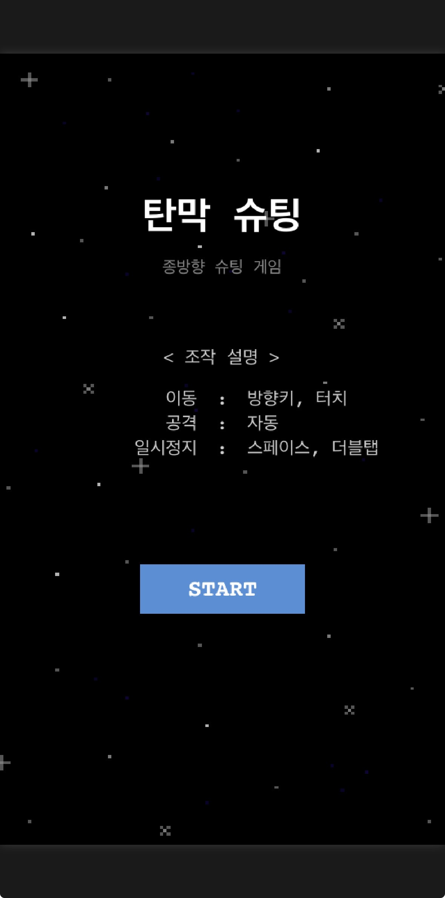
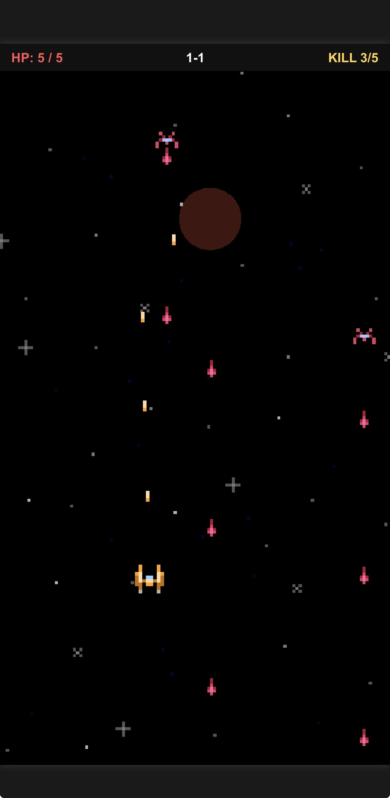
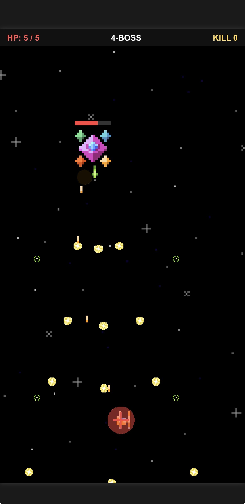
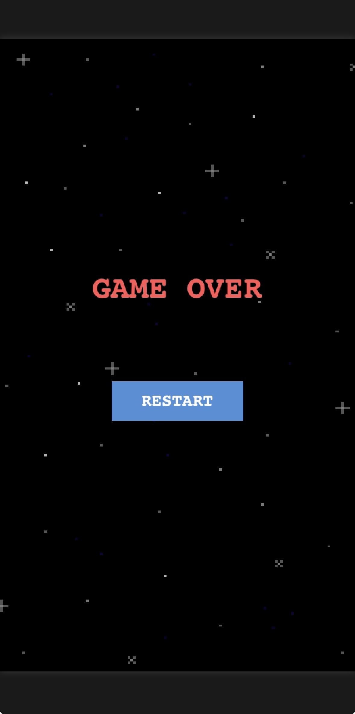

# SpaceShooter

Phaser 3를 활용하여 개발한 세로형 탄막 슈팅 게임입니다.

플레이어를 조작하여 적의 공격을 피하고 적을 격파하며, 각 스테이지의 웨이브를 진행하는 방식의 2D 슈팅 게임입니다.

## 1. 프로젝트 소개

- **프로젝트명:** SpaceShooter
- **개발 형태:** 2인 팀 프로젝트
- **개발 목적:** JavaScript와 Phaser 프레임워크를 활용한 게임 개발 및 게임 시스템 구현 경험
- **게임 장르:** 2D 세로형 슈팅 게임
- **개발 기간:** 7일
- **개발 인원:** 개발 1명, 기획 1명


## 2. 개발 환경

| 구분 | 사용 기술 |
|---|---|
| Language | HTML, CSS, JavaScript |
| Framework | Phaser 3.80.1 |
| Physics | Arcade Physics |
| IDE | Eclipse |
| Version Control | GitHub |
| AI | Codex, Claude |


## 3. 게임 소개

플레이어 기체를 조작하여 적의 공격을 피하고 적을 격파하는 세로형 슈팅 게임입니다.

스테이지별로 구성된 웨이브를 진행하며, 마지막 스테이지에서는 보스와 전투를 진행합니다.

### 조작 방법

| 조작 | 기능 |
|---|---|
| 방향키 / 마우스 커서 / 화면 터치 | 플레이어 이동 |
| 자동 공격 | 일정 간격으로 자동 총알 발사 |
| 스페이스바 / 더블 클릭 / 화면 더블 탭 | 게임 일시정지 |


## 4. 주요 기능

### 4-1. 플레이어 시스템
- 방향키 및 터치 입력을 통한 플레이어 이동
- 플레이어 체력 관리
- 자동 공격 시스템
- 적과 적의 탄환에 의한 충돌 처리

### 4-2. 적 시스템
- 적 종류에 따른 이동 및 공격 패턴
- 적의 체력 및 격파 처리
- 플레이어 방향을 고려한 탄환 공격
- 적 격파 수에 따른 웨이브 진행

### 4-3. 스테이지 및 웨이브 시스템
- 총 4개의 스테이지 구성
- 1~3스테이지는 각각 3개의 웨이브로 구성
- 마지막 4스테이지는 보스전으로 구성
- 웨이브별 적 격파 조건에 따른 다음 단계 진행
- 스테이지 전환 시 대기 시간 적용

### 4-4. 보스 시스템
- 보스 전용 공격 패턴
- 직선 및 다방향 탄환 공격
- 페이즈를 통한 패턴 변화
- 보스 체력 관리 및 격파 처리

### 4-5. 게임 화면 및 UI
- 시작 화면 및 게임 오버 화면
- 현재 스테이지와 웨이브 표시
- 플레이어 체력 표시
- 적 격파 수 표시
- 일시정지 기능


## 5. 게임 화면

### 시작 화면
<p align="left">
  
</p>

### 게임 플레이
<p align="left">
  
</p>

### 보스전
<p align="left">
  
</p>

### 게임 오버
<p align="left">
  
</p>


## 6. 프로젝트 구조

```text
SpaceShooter/
├── index.html
├── assets/
│   ├── images/
│   └── sounds/
├── js/
│   ├── config/
│   │   └── GameConfig.js
│   ├── scenes/
│   │   ├── BootScene.js
│   │   ├── ClearScene.js
│   │   ├── StartScene.js
│   │   ├── GameScene.js
│   │   └── GameOverScene.js
│   └── main.js
└── README.md
```


## 7. 개발 중 발생한 문제 및 해결

### 스테이지 및 웨이브 진행 처리
- **문제:** 시간 기반으로 스테이지를 진행하는 방식에서는 적을 모두 격파하지 않아도 다음 단계로 넘어가는 문제가 발생할 수 있었습니다.
- **해결:** 적 격파 수와 웨이브별 목표 수를 기준으로 진행하도록 변경했습니다. 적이 모두 격파되고 조건이 충족되면 다음 웨이브로 넘어가도록 구현했습니다.

### 적의 공격 패턴 구현
- **문제:** 적 종류와 상황에 따라 서로 다른 공격 패턴을 적용해야 했습니다.
- **해결:** 기존 공격 코드를 참고하여 비슷한 공격 기능에 맞게 수정하고, 탄환의 발사 각도와 방향을 조절하여 다방향 공격 패턴을 구현했습니다.

### 게임 화면 및 입력 처리
- **문제:** PC와 모바일 환경에서 모두 플레이할 수 있도록 입력 방식을 구성해야 했습니다.
- **해결:** 방향키와 터치 드래그 입력을 함께 사용할 수 있도록 구현하고, 화면 더블 탭을 통한 일시정지 기능을 추가했습니다.


## 8. 실행 방법

### 온라인 실행
별도의 설치 없이 아래 링크에서 게임을 실행할 수 있습니다.

- [SpaceShooter 바로 실행하기](https://wkdalstjr73.github.io/SpaceShooter/)

### 로컬 실행
1. GitHub 저장소를 Clone하거나 프로젝트를 다운로드합니다.
2. 프로젝트 폴더를 엽니다.
3. `index.html`을 브라우저에서 실행합니다.
4. 게임 시작 화면에서 플레이를 시작합니다.

※ 로컬 환경에서는 브라우저의 보안 정책에 따라 Live Server 등의 로컬 서버를 이용해야 할 수 있습니다.


## 9. 향후 개선 사항

- 적 이동경로 다각화
- 적 종류 및 공격 패턴 추가
- 스테이지별 난이도 조정
- 아이템 및 파워업 시스템 추가
- 모바일 화면 및 터치 조작 개선
- 게임 밸런스 및 충돌 판정 개선
